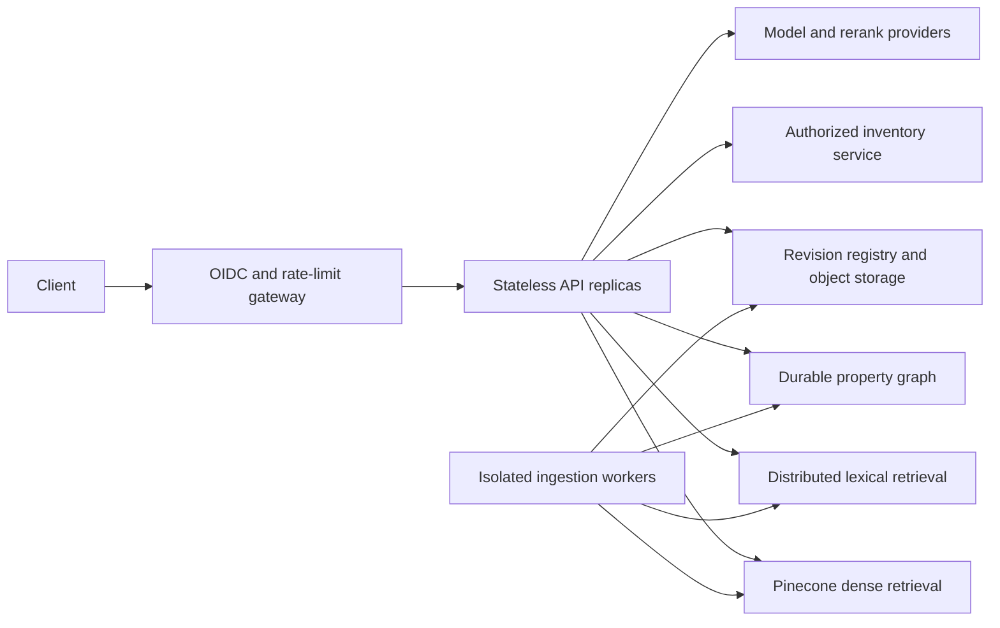

# Phase 2 production plan and deployment baseline

Phase 1 provides the three implemented RAG paths. Phase 2 is the production workstream below. Container and API safeguards are included, but the system is **not production-certified or publicly deployed**. Production readiness depends on your identity provider, real corpus, inventory contract, infrastructure and measured acceptance gates.

## Implemented baseline

- FastAPI typed requests/responses; question length bounds; errors do not expose raw provider exceptions.
- Bearer-token-to-tenant binding; no tenant field accepted as authorization; safe tenant IDs and namespace isolation.
- Per-tenant rate limiting and a four-request concurrency bound for one process.
- Prompt-free request logs with request IDs, tenant hashes and latency; liveness/readiness routes.
- External tool URL set only by the operator; HTTPS, no redirects, response identity validation, five-second timeout and 15-minute freshness bound.
- OpenAI timeout and bounded retry configuration; Pinecone data requests have explicit request timeouts.
- Read-only query API and separate operator ingestion; deterministic IDs; immutable revisions; local single-writer lock; snapshot hash verification.
- Non-root Docker runtime, read-only filesystem example, pinned Python requirements and CI checks.
- Tests for graph isolation, ambiguous IDs, citations, API auth/rate limits and stale/unavailable tools.

These controls are useful implementation, but do not make a distributed production service by themselves. The per-process limiter is not global, static tokens are not end-user SSO, readiness initialization is not continuous dependency probing, and LLM grounding verification is not a security boundary.

## Release work by building block

| Block | Concrete Phase 2 change | Acceptance gate |
|---|---|---|
| Identity | Put an OIDC gateway in front; validate issuer/audience/expiry; map authenticated membership to tenants; rotate service credentials | Cross-tenant and expired-token tests pass; tenant membership cannot be supplied by the caller. |
| Document permissions | Add source ACLs and apply them before dense/BM25/graph/tool retrieval | Revoked documents never reach prompts, caches or citations. |
| Corpus storage | Immutable object storage for originals/snapshots; transactional revision registry in PostgreSQL | Restore a snapshot and replay ingestion from source hashes. |
| Ingestion | Durable worker queue, bounded OCR workers, file sandbox, retries, dead-letter records and reconciliation | Interrupted jobs recover; deletions propagate; retry does not publish partial revisions. |
| Lexical search | Replace local BM25 with a language-aware search service when corpus size demands it | Same revision/ACL filtering; measured recall does not regress. |
| Knowledge graph | Persist canonical entities and source-backed edges in Neo4j or equivalent; parameterized allowlisted traversals | Two-hop correctness, identity-merge audit and deletion cascades pass. |
| Live tools | Implement inventory contract with service-side authorization and freshness guarantees | Timeout, stale, wrong-tenant, malformed, rate-limited and unauthorized responses fail closed. |
| Distributed control | API gateway or Redis-backed limits; bounded queue; end-to-end deadline and cancellation | Load test enforces total concurrency and spending budget across replicas. |
| Model dependencies | Retry only transient errors; add circuit breakers and explicit degradation policy | Provider outage returns bounded error/abstention; no retry storm. |
| Observability | Stage spans, token/cost metrics and alerting; redact source text by default | Trace identifies expensive/slow stage without exposing tenant data. |
| Evaluation | Human-reviewed golden set across language and document types; nightly regression run | Quality thresholds below pass on held-out data. |
| Release | Staging integration tests, canary, rollback and backup restore drills | Can revert model/prompt/index/snapshot as one versioned release. |

The API can be used behind a trusted gateway as a constrained pilot after cloud and corpus checks. Do not horizontally scale the local-memory limiter/BM25 baseline and assume global controls.

## Suggested deployment topology



This topology is a design target; only the single-process API/container is supplied as executable deployment configuration. No cloud IAM, network or managed-service resources were provisioned.

## Container baseline

```bash
# First complete local/cloud ingestion so data/snapshots contains the chosen revision.
docker compose build
docker compose up -d
curl http://127.0.0.1:8000/health/live
```

Compose binds only to loopback. Supply `.env` and mount the generated `data` directory read-only. TLS and public authentication belong at your gateway. Do not bake `.env` into an image. The image includes Tesseract language packs; operating-system packages and image digests still need release-specific pinning/scanning. Docker build and execution were not validated on this host.

## Proposed production targets

These are starting gates to agree with the application owner, not observed measurements:

| Metric | Proposed release target | How to verify |
|---|---|---|
| Faithfulness | At least 95% supported factual claims | Human review of every claim in a held-out representative set. |
| Citation validity | 100% resolvable authorized citation IDs | Deterministic check plus source-access tests. |
| Document recall@6 | At least 90% on labelled answerable cases | Stratify exact IDs, paraphrases, OCR and each language. |
| Unknown-answer behavior | At least 95% correct abstention on unanswerable cases | Include missing details, ambiguity, contradictory sources and injected instructions. |
| Latency | p95 below 10 seconds under agreed load | Measure each stage; current multiple LLM calls may exceed this. |
| Freshness | Documents <=24 hours; current inventory <=15 minutes | Upstream timestamps, job lag and end-to-end visibility checks. |
| Isolation | Zero unauthorized evidence across the test suite | Adversarial multi-tenant queries and deletions. |
| Recovery | Agreed RTO/RPO, proven by restore drill | Restore corpus registry, graph and index revision pointers. |

Do not ship solely on an aggregate average. A weak OCR language or tool outage path can be hidden by excellent English-text results.

## Performance and cost plan

Measure first. The current workflow can make planning, generation and verification model calls, plus embedding and reranking calls. Parallel dense/BM25 retrieval does not remove model latency. Consider deterministic routing for simple exact-ID cases, smaller candidate sets, a calibrated local verifier or batched ingestion only after quality comparisons.

Budget includes ingestion embeddings (more for semantic chunking), OCR compute, Pinecone storage/reads, rerank requests, and model input/output tokens. Record token and request usage from real responses rather than assuming a fixed price. Current provider prices and plan limits should be checked at deployment time.

## Data lifecycle and security tests

Test malicious instructions embedded in source documents, a tenant ID in the query body, ambiguous addresses, oversized files, stale status, forged tool identifiers, removed listings, partially visible upserts and provider timeouts. Enforce permission checks before evidence reaches a model. Add retention/deletion workflows across originals, chunks, graph edges, indexes, traces and backups.

Real estate production sources can include personal and contract information. Minimize stored fields, keep credentials in a secret manager and establish approved use of listing content. Do not use inferred demographics or unsupported financial/legal conclusions in answers.

## Runbook

1. Dependency outage: fail closed; inspect request ID and stage metrics; do not serve stale status as current.
2. Bad corpus revision: restart against prior verified `CORPUS_REVISION`; investigate before removing data.
3. Credential exposure: revoke/rotate at provider and deployment secret store; audit access without logging secrets.
4. Stuck ingest lock: verify no writer remains, inspect partially written remote namespace, then retry unchanged input or use a new revision.
5. Quality regression: compare stage-level retrieval results and model/prompt versions; roll back the complete release contract.

References and alternatives for every service above are collected in [RESOURCES.md](RESOURCES.md).
