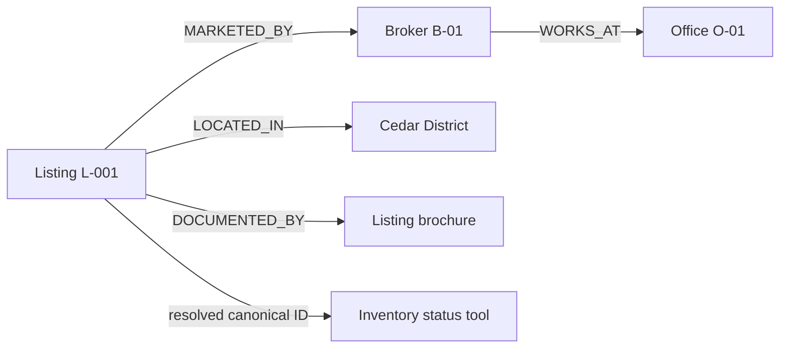
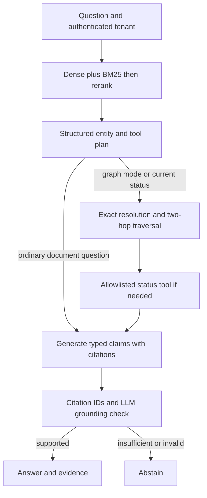

# Project guide

## Project one-liner

Estate RAG helps property researchers and brokers answer listing, document and relationship questions from a versioned corpus of listing brochures, screenshots, multilingual PDFs and brokerage relationships through an API, targeting 95% claim faithfulness and p95 response latency below 10 seconds after Phase 2 optimization. These are targets, not measured results.

## Scope from the handout

The supplied Week 2 handout asks for a corpus, chunking, embeddings, retrieval, cited answers and evaluation. Your request extends that into three implementations within one application and a second production phase. The supplied handout is not indexed as property evidence. Its suggested solution links, submission form and contact details are not operational instructions to this application.

| Framework field | Project decision |
|---|---|
| Use case | Property researchers ask exact listing, cross-document and multi-hop brokerage questions through an authenticated API. |
| Corpus | Ten synthetic demonstration documents: six listing sheets, one relationship source, a Spanish PDF, an English screenshot and a French scanned PDF. Real owners would be the brokerage content team and inventory service. |
| Ingestion and cleaning | Trusted CLI loads manifest files; native text or OCR is extracted per page; null bytes are removed; blank text is excluded. Low-confidence OCR fails ingestion for operator review. |
| Ingestion and freshness | Phase 1 uses explicit immutable revisions; Phase 2 targets document refresh within 24 hours and inventory responses no older than 15 minutes. Those SLAs require upstream and operational validation. |
| Chunking and embedding | Default recursive 400-token chunks with 60-token overlap, multilingual-capable `text-embedding-3-small`, explicit 1536 dimensions. Fixed and semantic variants are also implemented for comparison. |
| Retrieve | Pinecone dense top 20 and BM25 top 20 are fused by reciprocal rank, then reranked to six evidence chunks. |
| Generate | LangChain typed planning, claim generation and grounding verification, executed as a LangGraph state machine. |
| Refuse | Unknown/ambiguous graph entities, unavailable status tools, invalid citation IDs, empty claims or rejected grounding yield an explicit abstention. |
| Evaluate | Twenty labelled cases, dense/BM25/hybrid/hybrid+rerank ablations, ten graph questions, document-level recall/MRR/nDCG, abstention correctness and human claim checks. |
| Surface | CLI and FastAPI interactive documentation. A separate visual chatbot is optional and not needed to exercise the pipelines. |

Embedding dimension is not a rule for chunk length. The handout's dimension/chunk-size suggestion is a heuristic; choose chunks empirically using model context limits, document structure and retrieval results.

## Building block 1 — Corpus and evidence contracts

`data/manifest.json` binds a relative path to a listing ID and language. `Chunk` retains source, page, modality and optional OCR confidence. Stable content hashes deduplicate identities. A local immutable snapshot is the authoritative text store, so dense and lexical results refer to identical chunk IDs.

```json
{"path":"corpus/spanish.pdf","listing_id":"L-001","language":"es"}
```

A real manifest should use approved exports and exact canonical listing IDs. Preserve source documents and revision provenance. Do not overwrite old records silently. DOCX citations use page 1 as a logical document locator because OOXML has no stable rendered page mapping; PDF page numbers are actual one-based page numbers.

## Building block 2 — Text, images and multilingual ingestion

The loader branches by file type. Native PDF text is read directly. A PDF page with raster images, very little native text, or `force_ocr=true` is rendered and OCRed. PNG/JPEG/TIFF screenshots are OCRed too. This covers text embedded in images even when other PDF text is selectable.

Tesseract receives `eng+spa+fra` by default; that is an explicit language-pack configuration, not automatic universal language recognition. Text remains in its original language. The semantic embedding branch bridges language differences; lexical BM25 matches original-language tokens and does not perform translation. OCR confidence is a quality signal, not a guarantee of factual correctness.

Failure handling is deliberately strict: encrypted/oversized PDFs and poor OCR fail the ingestion run; no incomplete snapshot is published. A trusted operator reviews or repairs the source and retries. Image preprocessing currently includes orientation and RGB conversion; deskewing and table reconstruction remain Phase 2 choices.

For floor plans or image-only features such as “does the kitchen have an island?”, add a vision model or visual retrieval. OCR cannot answer those from pixels alone.

## Building block 3 — Chunking experiments

Three strategies are executable via `--strategy`:

| Strategy | Implementation | Suggested use | Limitation |
|---|---|---|---|
| Fixed | `TokenTextSplitter`, 400/60 tokens | Controlled baseline | Can separate clauses and tables; token boundaries can split Unicode text. |
| Recursive (default) | Paragraph/newline/sentence/space separators with token length | Listing descriptions and page text | Does not preserve table semantics; tune per corpus. |
| Semantic | Adjacent sentence embedding similarity, boundary below 0.72; recursively cap at 400 tokens | Long thematic documents | Additional embedding calls; threshold is experimental, not calibrated. |

The semantic algorithm compares normalized adjacent vectors: `cosine(v_i, v_(i-1)) < 0.72` starts a new group. The subsequent size cap prevents unbounded chunks. Test threshold sweeps and document layout before claiming improvement. Parent-child, heading-aware and table-aware strategies are alternatives in the resource guide.

To compare strategies, ingest each into its own revision and evaluate identical questions:

```bash
CORPUS_REVISION=fixed estate-rag ingest --strategy fixed
CORPUS_REVISION=fixed python scripts/evaluate.py --out data/eval-results-fixed.json
CORPUS_REVISION=recursive estate-rag ingest --strategy recursive
CORPUS_REVISION=recursive python scripts/evaluate.py --out data/eval-results-recursive.json
CORPUS_REVISION=semantic estate-rag ingest --strategy semantic
CORPUS_REVISION=semantic python scripts/evaluate.py --out data/eval-results-semantic.json
```

These commands assume all OCR language packs are installed. Use `--manifest data/manifest-text.json` consistently on every ingest if running the text-only baseline.

## Building block 4 — Hybrid retrieval and reranking

`HybridRetriever` issues dense search and BM25 concurrently. The BM25 corpus is per tenant and revision; results from another snapshot are not mixed. RRF combines ranks rather than incompatible raw scores:

```text
RRF(chunk) = sum_over_rankings(1 / (60 + rank(chunk)))
```

A multilingual Pinecone-hosted `bge-reranker-v2-m3` then scores query/chunk pairs and selects six. RRF is candidate fusion; the learned reranker is a separate stage. A reranker score is not a calibrated probability that the answer is correct. The implementation uses citation validation plus a grounding verifier rather than an arbitrary “confidence > 0.8” claim.

Example: “L-002 elevator” benefits from exact ID matching; “a home where I can avoid stairs” benefits from semantic retrieval. An English query against a Spanish page relies primarily on the dense branch. Evaluate this behavior against your actual languages.

## Building block 5 — Knowledge graph and tools

The data graph has `Listing`, `Broker`, `Office`, `Neighborhood`, `Amenity` and `Document` nodes. Edges include `MARKETED_BY`, `WORKS_AT`, `LOCATED_IN`, `NEAR` and `DOCUMENTED_BY`. Each edge carries a source and evidence text.



“Which office employs the broker marketing L-001?” requires the listing-to-broker-to-office path. The application returns the relevant edge evidence to the generator. A name resolves only by exact normalized ID/name/alias. Ambiguous matches block the answer; it does not silently select a similarly named property.

The planner extracts entity mentions and whether the question needs current status. For current price/availability, the application invokes a LangChain tool with the resolved listing ID. It validates the response tenant, listing ID, currency and timestamp. The graph tool node catches a failed/stale response and abstains. It never executes arbitrary LLM-generated SQL, Cypher or URLs.

Default tool: a local synthetic inventory adapter, clearly labelled in returned evidence. Live option: an operator-configured HTTPS endpoint with bearer authentication and no redirects. The external service must implement tenant authorization itself; `X-Tenant-ID` is context, not proof of authorization.

The graph is built from explicit canonical records in the sample data generator. Custom corpora need curated `graph.json` entities/edges. Query-time entity extraction uses the LLM; automatic extraction of arbitrary document relationships is not implemented. A production extraction job should propose typed edges with exact evidence spans and send uncertain identity merges for review.

This is property-graph local RAG. It does not implement Microsoft GraphRAG's global community summarization. Also, **LangGraph is the workflow engine, not the knowledge graph database**. NetworkX is the local graph implementation; Neo4j is the suggested production alternative for durable indexed graph queries.

## Building block 6 — LangChain and LangGraph execution



Multimodal mode uses the same retrieval workflow over OCR-enriched documents; the modality distinction is in ingestion, not a separate search algorithm. All modes can retrieve original-language and OCR text. Graph mode adds relationship evidence. Current-status intent routes through the graph/tool path even if the caller selected hybrid mode, because stale brochure text cannot establish live status.

LangChain contributes document abstractions, splitters, embeddings, typed model outputs, prompt chains and tools. LangGraph contributes state, conditional routing and bounded execution. This graph has no looping agent and no persisted conversation memory; every request is independent.

## Building block 7 — Grounded answers

The generator returns atomic `Claim` objects. A deterministic gate rejects unknown citation IDs. A separate model verifies the draft against evidence. Only cited evidence is included in the response. Missing facts produce an abstention, not invented listing details.

This reduces unsupported answers but does not prove correctness: model-based verification can still fail or follow malicious evidence. Real deployment needs adversarial evaluation, human review of critical outputs, and authoritative structured fields for prices/status. Prompt strings are visible in `workflow.py` for inspection and iteration.

## Phase 1 completion checklist

Implemented: all three retrieval paths; three chunking strategies; synthetic corpus; index setup; typed evidence; graph/tool routing; tests; reproducible dependency file; evaluation runner and labelled cases.

To complete the live demonstration: add your API keys, install OCR packages, ingest, run the evaluation suite, inspect cited answers and record the actual results. Do not present the supplied test pass count as retrieval accuracy.

## Suggested five-minute demonstration

1. Explain corpus, user and target quality in 30 seconds.
2. Show exact-ID and paraphrased hybrid queries; inspect evidence and source pages.
3. Ask about the screenshot, then a cross-language question against the Spanish PDF.
4. Show the two-hop broker/office query and the status tool trace with its synthetic label.
5. Ask an unanswerable question, then show measured evaluation output and Phase 2 gaps.

The handout also describes a project overview, assets, evaluation and a short recording. This repository supplies the source material for that documentation. No video or live cloud evaluation has been fabricated.
